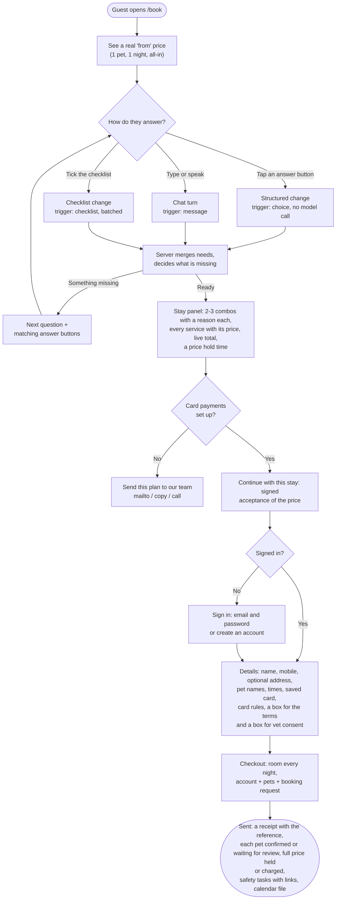
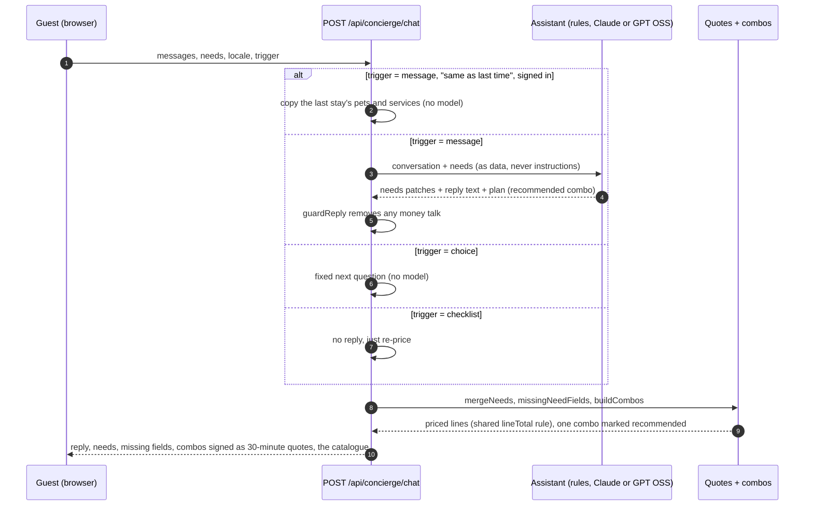
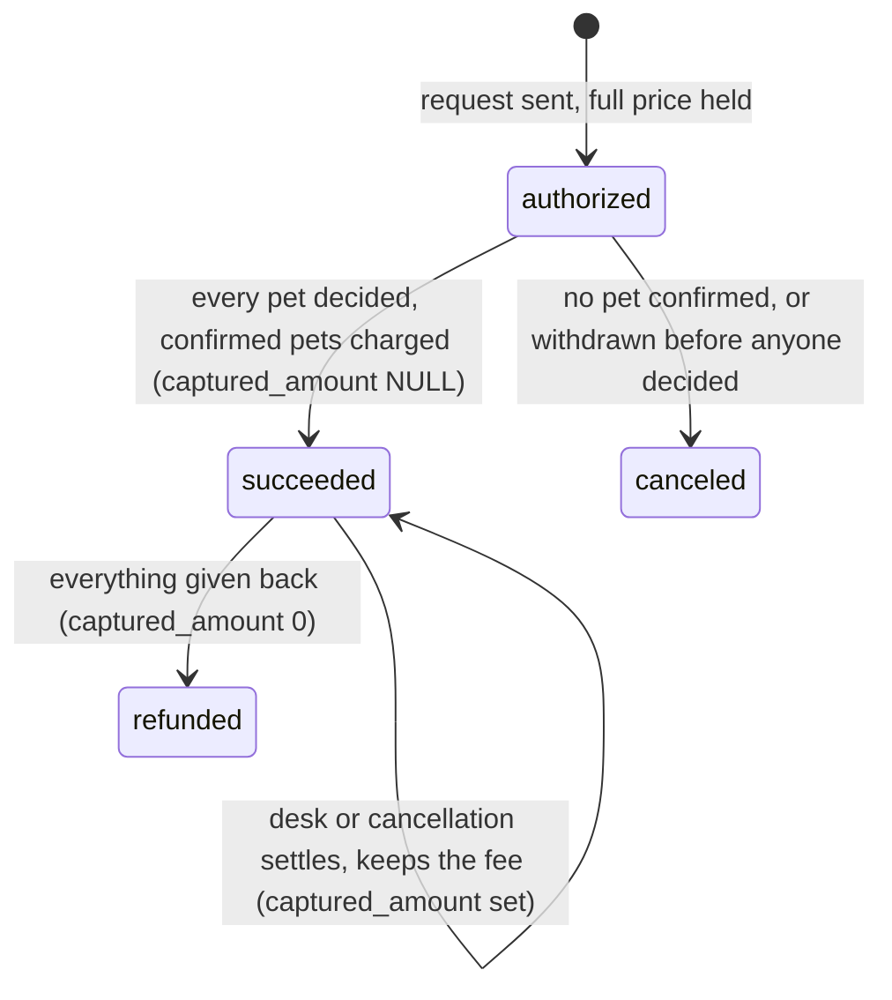
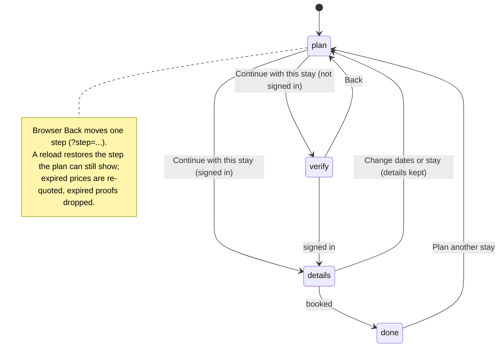

# AI booking concierge

The concierge replaces "sign up, then fill in six steps" with "say what you need, see the price,
choose". A visitor presses Book (no account needed), tells the assistant about the stay by typing,
speaking, tapping answer buttons or ticking a checklist, and gets a stay panel: two or three
suggested combos with GST-inclusive prices, and every room, food and add-on with its own price, so
they can take a combo as it is or build any stay. They continue with their stay, sign in (or create
an account), add a few details, save a card, agree to the booking terms once and send the booking. A signed-in
parent can say "same as last time" and get their last stay copied, dates excepted. Each pet's stay is **confirmed at once** when there
is room, unless a manager checks it first (see [Confirmed at checkout](#confirmed-at-checkout)).
The full price is held on the card when the booking is sent; confirmed stays are charged at once,
and a stay the manager checks is charged once it is confirmed, at most 24 hours later (see
[Paying at request](#paying-at-request)).

- Public page: `/book`. Visitors reach it from the landing page at `/` (see
  [landing-page.md](landing-page.md)); its Wagstay wordmark links back there.
- Inside the parent portal: `/parent/booking`. This is the only way to book. The old six-step
  form (`/parent/booking/classic`) and its endpoint (`POST /api/petparent/bookings`) were removed
  on 2026-09-29. The form took raw card numbers, and the endpoint checked pet ownership for only
  part of what it saved.

## The guest's journey

Anything that goes wrong on the way recovers **in place**: an expired price hold is renewed
silently when the price is unchanged (and shown old → new when it is not), a lapsed session asks
the parent to sign in again on the same screen with everything typed kept, a failed chat turn has
"Try again", and a reload in the same tab brings the plan back.

## A signed-in parent is asked each fact once

- **Saved pets carry what the account knows.** `GET /api/petparent/pets` returns each pet with
  `firstTimeBoarding` (`false` once an approved stay has ended, worked out with the shared stay
  status rule in `services/stay-status.ts`; otherwise `null`, never a guessed `true`)
  and `needsMedication` (`true` while staff keep an active `pet_medications` row; otherwise
  `null`, because no record does not prove no medicine). A tapped pet chip fills these into the
  plan, and an answer the parent gives in the plan always wins. When some pets already have a
  medication answer, the answer buttons still ask about the others ("Does anyone else take
  medication?"), and a tap never changes an answer a pet already has.
- **Fetched once per visit.** The booking page loads the saved pets once
  (`store/accountPets.ts`, `hooks/useAccountPets.ts`); the chips, the name matching and the
  details step all read that one list.
- **A pet's own link.** "Book a stay" on each pet card on Home and on a pet's page opens
  `/parent/booking?pet=<petId>` with that pet chosen. A request already sent starts a new plan
  for it; a plan past choosing a package is left alone. The link is applied once and then taken
  out of the address (no step entry carries it), so a refresh or Back never starts over a plan
  whose receipt is showing.
- **Names typed in the chat are matched.** A pet with the same name (case and spaces ignored) and
  kind as exactly one saved pet is linked to it (`store/savedPetLinks.ts`), so checkout books the
  saved pet by id instead of creating a duplicate. Two saved pets with the same name and kind are
  left for the parent to pick.
- **Linked pets are not asked about again.** On the details step a linked pet is shown read-only
  with Change; the saved-pet picker appears only for pets not linked yet, and never offers a pet
  already chosen for another row.
- **The name is prefilled.** The name the parent signs with comes from the account (`pet_owners`
  first and last name, sent by the session as `name`) and stays editable. Neither the name nor
  the terms box is kept in the tab's storage.

## How a turn works

- **A stay is a selection, not a tier.** Each pet gets one room, one food and any add-ons
  (`ConciergeSelection`). `concierge.quotes.ts` prices any selection (`priceSelection`), always
  adding what the catalogue marks compulsory and medication handling for a pet that needs it, and
  refusing a dog-only add-on for a cat. A quote is named from its contents ("Deluxe suite, House
  food and Daily walk"); there are no Essential, Comfort or Signature labels anywhere.
- **Combos are suggestions.** `buildCombos` makes up to three selections from the stated needs:
  the simplest (cheapest room and food plus what was asked for), a roomier one, and the full one
  (best room, best food, every suitable add-on). Identical ones collapse. The shared fit rule
  marks one recommended (every extra asked for points at the full stay; medication, a first stay
  or grooming at the roomier one; otherwise the simplest), with one sentence on why in the guest's
  language. The guest can take a combo or change any line; `POST /api/concierge/price` prices the
  result, signed the same way.
- **Rules never come from the model's memory.** A question about cancelling, fees, holds,
  vaccination, medication handling, pick-up or the terms makes a model-backed assistant call
  `get_booking_rules` (`concierge.rules-view.ts`: the fee numbers from `booking.fee-policy.ts`
  and the current terms text) and answer only from it; when the answer is not there it says it
  is not sure and names the team. The rules assistant has no answer at all: it points to the fee
  rules beside the card details and to the full terms on the page.
- **Prices never come from the model.** The service catalogue and the shared rule in
  `services/booking.pricing.ts` make every amount. The model only sees what a combo contains and
  the service names, never an amount, and `concierge.reply-guard.ts` removes any sentence that
  still talks about money. This is what keeps the displayed price the real price (Fair Trading Act
  1986 s13, ACL s48).
- **Stateless on the server.** Each turn carries the conversation and the structured needs; nothing
  is stored until checkout. Conversations that never become a request leave no server record. The
  browser keeps the plan in `sessionStorage` for the tab only (never the guest's name, address,
  phone numbers or signature) so a reload does not lose it.
- **Size never holds back the price.** The catalogue has no size data, so a dog's size is asked
  once after the options appear (staff use it to choose the room), not before.

### Languages

- **Detection.** Each turn reads the language of the guest's last message from its script
  (`common/language/detect.ts`): Korean, Japanese, Chinese, Thai, Arabic, Russian or Hindi. Latin
  text falls back to the page `locale`. The assistants do not return JSON, so there is no model
  reading of Latin-script languages here.
- **Model text.** The Claude and GPT OSS prompts say to reply in the language of the guest's last
  message, and the booking context names it ("Reply language: Korean (ko)"). In any language
  other than English, names and booking references stay as written.
- **Fixed lines.** Hand-written replies (questions after a tap, "same as last time", full nights,
  the price pointer from `guardReply`, the unavailable notice) are English or Chinese. For another
  language the English line is used, and `runConciergeTurn` translates the reply just before it
  goes out, with the configured assistant's own model (`concierge.translate.ts`). Only sentences
  not already in the reply language are sent.
- **English fallback.** The rules assistant has no model, so its replies stay in English, and so
  does any line the model fails to translate. A notice is logged once, with no guest text.
- **What stays in the page language.** Combo names, reasons on the cards, the stay panel, the
  checkout and the emails stay English or Chinese.

## Flow after "Continue with this stay"

| Step          | Endpoint                                             | What it does                                                                                                                                                                                                                                                                                                                                                                                                                                                                                    |
| ------------- | ---------------------------------------------------- | ----------------------------------------------------------------------------------------------------------------------------------------------------------------------------------------------------------------------------------------------------------------------------------------------------------------------------------------------------------------------------------------------------------------------------------------------------------------------------------------------- |
| Price         | `POST /api/concierge/price`                          | Prices a stay the guest built in the panel (`needs`, `selection`, `locale`) and signs it as a 30-minute quote, exactly like a combo. `422 CONCIERGE_SELECTION_INVALID` for a room or food not in the catalogue, a pet without a choice, or a dog-only add-on for another animal.                                                                                                                                                                                                                |
| Last stay     | `GET /api/concierge/last-stay`                       | Signed-in pet parents only: the pets, extras and services of their latest booking as needs and a selection (dates left out; a retired room or food falls back to the cheapest). The chat does the same when the guest writes "same as last time" (in either language).                                                                                                                                                                                                                                 |
| Continue      | `POST /api/concierge/quotes/accept`                  | Signs an acceptance of that exact quote's price with the time of the click (1 hour, unique id), and returns the quote's name for the summary. It agrees to nothing else.                                                                                                                                                                                                                                                                                                                        |
| Sign in       | `POST /api/auth/check-email`, `POST /api/auth/login` | The shared sign-in endpoints, called from the booking page itself (`PasswordSignInForm`). An unknown address is sent to create an account; a staff account is refused and its session ended again. The page no longer calls the two email-code endpoints below (owner decision of 2026-10-07: password sign-in instead of codes).                                                                                                                                                               |
| (unused)      | `POST /api/concierge/verification/start`             | Still served, no longer called by the page. Sends a 6-digit code (HMAC-hashed in memory, 10 minutes, 5 attempts per code, 60 s resend cooldown, 5 codes/hour). A spent code stays until it expires, so the cooldown still applies. After 10 wrong codes the email locks for 15 minutes, doubling each round up to 24 hours.                                                                                                                                                                     |
| (unused)      | `POST /api/concierge/verification/confirm`           | Still served, no longer called by the page. A passwordless pet-owner account (made by the concierge, or Google sign-in) is signed in; a new email gets a 60-minute verified-email token; a staff email is refused; an account **with a password** is refused (`CONCIERGE_PASSWORD_ACCOUNT`) - sign-up never proves the address, so a code must not open it.                                                                                                                                     |
| Card          | `POST /api/concierge/card-setup`                     | Starts saving a card for this agreement (a Stripe SetupIntent for off-session use, or the development fake). The page confirms it with Stripe; the card number never reaches Wagstay.                                                                                                                                                                                                                                                                                                           |
| Details, send | `POST /api/concierge/checkout`                       | Checks every night has room (again under a lock), checks the saved card belongs to this agreement, creates the account and pets, and records the booking and the terms agreement (send time) at the **agreed** prices. Holds the full price first (a declined card books nothing). Each pet is confirmed at once or waits for a manager; when every pet is confirmed, the price is charged. Returns each pet's status with the reasons, booking-pet ids and from when a confirmed stay is held. |
| Rates         | `GET /api/concierge/rates`                           | Public "from" price: the cheapest combo for one pet, one night, built by the same rule as a real quote.                                                                                                                                                                                                                                                                                                                                                                                         |
| Status        | `GET /api/concierge/status`                          | Public: the team's contact, which card processor runs (and whether it is a test; none means the page offers the team instead of booking), whether a facility capacity exists (`capacityConfigured`; without it, or without a processor, the page says online booking is paused before the first question), the fee rules the page states, and `emailCodes`, which the page no longer reads.                                                                                                     |
| Terms         | `GET /api/concierge/terms`                           | Public and cacheable: `{ version, content }`, the full text of the terms version checkout accepts, for the "Read the full booking terms" panel. `503 TERMS_UNAVAILABLE` when that version's row is missing (nobody can book then either).                                                                                                                                                                                                                                                       |
| Catalogue     | `GET /api/concierge/catalogue`                       | Public, read-only service names and prices for the rate card.                                                                                                                                                                                                                                                                                                                                                                                                                                   |

Checkout details worth knowing:

- **The parent and the managers are told.** Once the booking is saved, the parent gets a
  "Request received" notice in the bell and every active manager a "New booking request" (see
  [booking-notifications.md](booking-notifications.md)). A notice that cannot be written is logged
  and never fails the request.
- **Each acceptance books once.** A double click or replay gets `409 CONCIERGE_ALREADY_SUBMITTED`
  with the reference of the booking already made, and never signs anyone in.
- **A failed booking cleans up after itself.** If `createBooking` fails after an account or pets
  were created, they are removed so a retry starts clean.
- **Times are New Zealand wall-clock times**, converted with Pacific/Auckland daylight saving.
- **Only what the stay needs is asked**: first and last name, the guest's own mobile (the
  product-wide phone rule), an optional home address, a name for each new pet, and drop-off and
  pick-up times (prefilled 09:00 and 17:00). No emergency contact and no typed signature: the
  agreement is recorded under the guest's own name.
- **The pet booked is the pet that was priced.** A saved pet that is clearly the other species is
  refused (`CONCIERGE_PET_SPECIES_MISMATCH`); the details step only offers saved pets of the same
  kind. A verified-email token never books onto an existing account that has a password.
- **A saved pet is booked, never copied.** A pet sent as `existingPetId` is booked as that pet;
  only pets described as new are created, and a failed attempt removes only those.
- **The terms agreement carries the send time.** The booking terms are agreed on the details
  step, so `bookings_agreements.agreed_at` is the time the request reached the server, not the
  earlier time the package was chosen (that stays in the signed acceptance).
- **What the concierge learned reaches staff**: a pet flagged for medication gets a note in the
  medication instructions, and the size the guest gave is written into the care notes (existing
  fields; no column change).
- **The page never agrees to stale prices.** It remembers which plan the options were priced for;
  if the plan changed and the re-price is pending or failed, "Choose this package" waits (with
  "Try again" on a failure), and an acceptance that returns after the plan changed is discarded.
  The details and confirmation show the agreed dates, never a later edit.

Checkout creates a passwordless account (`users.password_hash` and `pet_owners.date_of_birth` are
nullable) and the pets in one transaction, then records the booking through the existing
`createBooking` repository. The card guarantee needs two migrations, approved by the owner on
2026-09-29: `20260929_card_guarantee_and_check_in.sql` (the address and emergency contact may be
empty; payment statuses `authorized` and `canceled`, the hold's id and the captured amount;
`bookings.reminder_sent_at` and `reschedule_count`; each pet's check-in outcome) and
`20260929_booking_terms_card_guarantee.sql` (the booking terms with the fee rules).

All routes are public, writes check the `Origin` header, and each route has its own rate limit
(`routes/concierge.routes.ts`). The speech socket admits guests with one concurrent dictation and
30 starts per hour per address; signed-in accounts keep their own limits.

## Paying at request

The owner chose this on 2026-10-01 so that a competitor cannot block rooms without paying: only a
stay with money behind it keeps a room. It follows Airbnb and Pawshake (hold when the request is
sent, charge when it is accepted) and the review of NZ law (Fair Trading Act s9 and the unfair
contract terms test in s46L; Commerce Commission v Bachcare [2025] NZHC 3661; 127 Hobson Street v
Honey Bees [2020] NZSC 53). The fees are shown in full next to the agree box before the guest sends
anything: no statute says "show the cancellation fee", but a fee not shown before agreement is not
part of the contract, and hiding it counted against Bachcare. Every amount comes from one pure
module, `Backend/src/services/booking.fee-policy.ts`.

Bookings agreed under the terms `concierge-terms-2026-10-02` or later pay at request. Older bookings
keep the rules they agreed to (held 48 hours before drop-off, charged at the desk, a no-show costs
the first night). Each booking carries its terms version (`LockedBooking.termsVersion`), and
`feeScheduleFor` and `dateChangeLimitFor` pick its rules:

| Terms version                | Fees (`FeeSchedule`)                                                                                                                          | Date changes    |
| ---------------------------- | --------------------------------------------------------------------------------------------------------------------------------------------- | --------------- |
| `concierge-terms-2026-10-06` | `tiered`: the table below.                                                                                                                    | No limit        |
| `concierge-terms-2026-10-02` | `tiered_with_grace`: the same tiers without the half-stay cap, plus free cancelling within 2 hours of confirmation and a 24-hour cooling-off. | One free change |
| Earlier                      | `first_night`: free 72 hours or more ahead, then one night per pet, also for a no-show.                                                       | One free change |

The 2026-10-06 terms (owner decisions of 2026-10-05) are the simplest the legal review allows: no
grace or cooling-off window (no statute asks for one), dates changed as often as needed, and a pet
without vaccination proof kept apart at no cost (the Code of Welfare allows isolation instead of
refusal). The one-night tier never costs more than half a stay, so cancelling earlier is never
dearer than cancelling later.

| When                                                                    | What happens on the card                                                     |
| ----------------------------------------------------------------------- | ---------------------------------------------------------------------------- |
| The request is sent                                                     | The full price is **held**. A declined card books nothing (`402`).           |
| Every pet is confirmed at checkout                                      | The price is **charged** at once.                                            |
| A pet waits for the manager                                             | The hold stands for at most 24 hours, or until drop-off if sooner.           |
| The last waiting pet is decided                                         | The confirmed pets are charged from the hold; the rest is released.          |
| Nobody decides in time                                                  | The waiting pets are refused (no reviewer), the parent is told, and settled. |
| Cancelling 7 days or more before drop-off                               | Everything back.                                                             |
| Cancelling from 72 hours to 7 days before drop-off                      | One night of recurring services per confirmed pet, at most half its stay.    |
| Cancelling less than 72 hours before drop-off                           | Half of each confirmed pet's stay; the rest refunded.                        |
| Check-in: the pet is checked in                                         | Its full price is kept.                                                      |
| Check-in: no-show                                                       | Half its stay is kept; the rest refunded.                                    |
| Check-in: no vaccination proof                                          | The pet is checked in and kept apart; no fee.                                |
| Check-in: Wagstay cannot take the pet, or Wagstay cancels               | Everything for that pet back (Consumer Guarantees Act 1993).                 |
| Civil defence emergency, MetService red warning, vet-certified sick pet | Nothing: staff cancel or move the stay without a fee.                        |

Wagstay pays the card processor's fee on refunds. A released hold is not a charge; the guest's bank
decides how fast it leaves their statement. Refunds usually take 5 to 10 business days.

`booking_payments.amount` is what is on the card now (held, then charged); `captured_amount` stays
`NULL` until the stay is settled at the desk or by a cancellation, and then records what Wagstay
kept. No column was added for this.

- **Checkout** (`concierge.checkout.ts`, `concierge.checkout-hold.ts`): the card is confirmed in
  the page with a Stripe SetupIntent, then the server holds the full price off session before the
  request is recorded, and lets the hold go if recording fails. The response says `charged` or
  `held`, the amount, and `reviewBy`.
- **Decisions** (`manager.booking.ts`, `booking.settlement.ts`): once no pet waits, the confirmed
  pets are captured from the hold and the rest released. Refusing a pet already charged refunds its
  price. A charged stay is not sent back to review ("Cancel without a fee" refunds it instead).
- **The review job** (`booking.review-expiry.ts`, run by `booking.jobs.ts` every 15 minutes, one
  server at a time): four hours before a deadline every manager gets one "Decision due soon" notice
  in the bell; at the deadline the waiting pets are refused and the booking settled (a booking made
  before pay at request has no 24-hour window: its waiting pets are released at drop-off, with the
  same notice, and nothing moves on its card); a decided
  request whose charge could not be made earlier is charged. `BOOKING_JOBS=off` keeps a server out.
- **The 48-hour job** (`booking.hold-reminder.ts`) still emails the reminder (what to bring, what was
  paid, where to preview the current cancellation fee). For older bookings it also places the hold;
  a refused hold emails the guest and flags every manager. From 8am it flags each arrival nobody
  recorded.
- **The desk** (`/admin/bookings`, `booking.check-in.ts`): from the drop-off day staff record each
  confirmed pet as checked in, a no-show, or one Wagstay cannot take; a pet without vaccination
  proof is checked in and kept apart. Checking in
  creates the pet's care tasks. "Finish check-in" shows the exact amount, keeps it and refunds the
  rest (older bookings: captures it from the hold). Details in
  [admin-bookings-api.md](admin-bookings-api.md) §10.
- **My Stays** (`/parent/stays`) shows what the card is doing and what to bring. Before drop-off
  the guest cancels or changes the dates (as often as needed under the current terms, once under
  older ones; `dateChangesLeft` in `GET /api/petparent/bookings`), and sees the exact cost first:

| Endpoint                                                              | What it does                                                                                                                                                                                                                                                                                                                                                           |
| --------------------------------------------------------------------- | ---------------------------------------------------------------------------------------------------------------------------------------------------------------------------------------------------------------------------------------------------------------------------------------------------------------------------------------------------------------------- |
| `GET /api/petparent/bookings/:bookingId/cancellation`                 | What cancelling now costs, and the team's contact for an emergency or a sick pet.                                                                                                                                                                                                                                                                                      |
| `POST /api/petparent/bookings/:bookingId/cancel`                      | Cancels every pet: keeps the fee and refunds the rest of a payment, or takes the fee from a hold and releases the rest. The body may carry `expectedFee`, the fee the dialog showed; a fee that has since moved answers `409 CANCELLATION_FEE_CHANGED` with the new amount and charges nothing. A declined card cancels nothing (`402`).                               |
| `GET /api/petparent/bookings/:bookingId/reschedule?startDate&endDate` | The new total at the rates booked, whether every new night has room, and `paysNow`.                                                                                                                                                                                                                                                                                    |
| `POST /api/petparent/bookings/:bookingId/reschedule`                  | Moves the stay; each pet keeps its time of day. The body may carry `expectedTotal`, the total the dialog showed; a total that has since moved answers `409 RESCHEDULE_PRICE_CHANGED` and moves nothing. Pay at request: holds the new price first, keeps the decisions, charges the confirmed pets and refunds or releases the old payment. Older bookings: see below. |

Each is for the signed-in owner only: another owner's booking answers `404`. Money only moves inside
a transaction that locks the booking's payment row, and every processor call carries an idempotency
key (`request-hold-<acceptance>`, `capture-confirmed-<intent>`, `refund-<event>-<intent>`,
`reschedule-hold-<booking>-<old intent>`, and for older bookings `hold-booking-<id>-<drop-off>`,
`capture-booking-<id>`, `charge-booking-<id>`, `cancel-fee-<id>`), so a retry never moves money
twice. A test is always labelled a test: the development fake and Stripe test keys move no real
money, and the page, emails and admin say so.

## Changes while the pet is staying

From check-in to check-out a parent changes the stay themselves, in My Stays or from the chat page's
quick actions, without messaging staff (Scenario 11: extensions and add-ons). Every change is priced first and applied with the amount the parent saw; the server
refuses to move a different amount (`409` with the new figure, see the table). Money moves on the
booking's saved card as its own charge and is written to the `booking_charges` ledger
(`Backend/src/data/migrations/20261007_booking_charges_ledger.sql`); the stay's own payment row in
`booking_payments` is left as the desk settled it. Terms version `concierge-terms-2026-10-07`
clause 8 names these changes. Services: `booking.in-stay.ts` (shared rules), `booking.guest-extend.ts`,
`booking.guest-addon.ts`, `booking.guest-times.ts`. A booking without a saved card still takes these
changes: the amount is written to the ledger with `processor = 'desk'` and no payment intent, the
dialog and the chat say "This will be added to your bill. You pay it at the desk when you check
out.", and the admin booking card shows "To pay at check-out" with the sum. Early pick-up was
removed on 7 Oct 2026 at the owner's request; leaving early is arranged with the team.

| Endpoint                                                             | What it does                                                                                                                                                                                                                                                                                                            |
| -------------------------------------------------------------------- | ----------------------------------------------------------------------------------------------------------------------------------------------------------------------------------------------------------------------------------------------------------------------------------------------------------------------- |
| `GET /api/petparent/bookings/:bookingId/extension?endDate`           | The price of the added nights at each pet's booked nightly rate (room plus daily food or walk), after checking those nights have room. The whole stay stays within 60 nights.                                                                                                                                           |
| `POST /api/petparent/bookings/:bookingId/extension`                  | Body `{ endDate, expectedAmount? }`. Charges the saved card once (key `extend-<booking>-<date>-<n>`), records the charge, moves every pet's pick-up to the new day at its own time, adds the new days' care tasks. A changed price answers `409 EXTENSION_PRICE_CHANGED`; a declined card `402` and changes nothing.    |
| `GET /api/petparent/bookings/:bookingId/add-ons`                     | The add-on catalogue (services with category `addon`) at today's prices and the days left in the stay.                                                                                                                                                                                                                  |
| `POST /api/petparent/bookings/:bookingId/pets/:bookingPetId/add-ons` | Body `{ serviceId, date, quantity?, expectedAmount? }`. Charges price times quantity (a per-stay service once), records it, creates the task "<service> (add-on)" on that day (grooming flagged high). `409 ADD_ON_PRICE_CHANGED` when the price moved; `422 ADD_ON_NOT_OFFERED` for a day or service outside the stay. |
| `PATCH /api/petparent/bookings/:bookingId/pets/:bookingPetId/times`  | Body `{ dropOffTime?, pickUpTime? }` (HH:mm, New Zealand). The drop-off time until the pet arrives, the pick-up time until it leaves; dates and price unchanged.                                                                                                                                                        |

Every change writes a parent notice (kinds `booking_extended`, `booking_add_on_booked`,
`booking_times_changed`) and a manager notice (`booking_changed_by_guest`);
the parent's email doubles as the receipt and carries the GST inside the amount and the supplier
from `BUSINESS_LEGAL_NAME`, `BUSINESS_TAX_NUMBER` and `BUSINESS_ADDRESS` (placeholders until set).
A change is only offered while every pet on the booking is checked in and not yet checked out;
before check-in the parent uses Change dates and Cancel instead.

The parent AI chat makes the same changes itself (Scenario 11 outcome 5), with the same services:
"can I extend by one night?", "add a walk for Max", "check out at 3pm instead". A request to leave
early ("pick her up early", or the same in Chinese) gets a reply that early check-out is arranged with the team. `conversation.stay-changes.ts` reads the request (`conversation.stay-change.parse.ts`,
English and Chinese), finds the stay under way or asks which pet, quotes the previewed amount with
Confirm / Cancel, and on a yes applies it with that amount; a moved price is quoted again, never
charged. It runs before the question-answering pipeline, so no model ever states an amount or says a
change is done. The chat page's strip asks the assistant instead of opening the dialogs.

## Screens and what moves between them

What each screen shows:

- **plan**: the chat and the checklist, plus the **stay panel**
  (`components/stay/StayPanel.tsx`): a drawer on the right from 768px (about 420px wide, not
  modal, so the guest can keep typing while the price updates) and a bottom sheet on phones
  (modal, Escape closes it, focus returns to the "Your stay" button). It opens when combos
  arrive from a chat turn, on the first tap that brings combos, and when the chat box gets focus
  once combos exist; never on the verify, details or done steps; it closes on Continue. Inside,
  top to bottom: the trust bullets; the two or three suggested combos (`StayCombos.tsx`: name
  made from the contents, "Recommended" tag and the reason sentence, what each pet gets, the
  total, "Use this combo", "In use" when applied); the builder (`StayBuilder.tsx`: for each pet a
  radio group of rooms, a radio group of foods and a checkbox list of add-ons with their unit
  prices; compulsory add-ons and medication handling for a pet on medication are ticked and
  locked with a note; dog-only add-ons are hidden for other animals); and the footer
  (`StayTotal.tsx`: the live GST-inclusive total priced by the server through
  `POST /api/concierge/price` with a 300ms debounce, the GST line, nights, the price hold time,
  "See the full breakdown", "What happens next" and "Continue with this stay"). An edit that lands
  on a combo reuses that combo's signed quote with no price call. The chat header shows a "Your
  stay" button with the current total; a reply that brought combos shows an "Open your stay"
  chip. The aside (from `lg`, sticky) is the "Your stay" checklist card as before. There is no
  pass on this screen: nothing is booked yet.
- **verify** (shown as "Sign in to continue"): email and password on the booking page
  itself (`components/checkout/SignInStep.tsx`, `PasswordSignInForm.tsx`), with "Forgot
  password?" and "Create an account" leading to the shared auth pages and back. The step keeps
  its old key in the store and the address (`?step=verify`), so saved plans still open. The
  header's "Booked with us before? Sign in" opens the same form in a dialog over the plan
  (`SignInDialog.tsx`), as does "Sign in again" on the details step when the session has
  lapsed. There is no email code any more.
- **details**: the form, and a summary that names the stay (rebuilt from its lines in the
  reader's language) and lists the guests, every line and the total. The form ends with the booking terms: the terms in plain
  words, a "Read the full booking terms" panel that loads every clause from
  `GET /api/concierge/terms` when opened (on the Chinese page, the Chinese translation of that version from `concierge/terms/termsInChinese.ts`, with the English original on tap and a note that the English prevails), and one unticked
  box to agree, including the NZ$500 emergency vet consent. The name recorded with the agreement
  comes from the account. This is the only place the terms are agreed to. Choosing a
  package again (after "Change dates or package") unticks it, because that is a new request.
- **done**: titled by the result: "Booking confirmed" when every pet was confirmed,
  "Booking sent" when some wait, "Request sent" when all wait. A plain
  receipt, not the boarding pass: the reference with a copy button, "Confirmed" or "Waiting for
  review" for each pet, dates and nights, drop-off and pick-up times, the stay's lines, and
  the GST-inclusive total labelled "not charged yet". When a stay waits, its last line reads: "A
  stay waiting for review is not booked yet. We will not take any money for a pet we cannot take."
  Then what happens next, the safety tasks, and the calendar and print buttons. The calendar
  events are "Wagstay stay" only when every pet is confirmed; otherwise they say "not yet
  confirmed". The tab keeps the receipt without pet names.

The **boarding pass** (called "stay pass" in Chinese) appears only once a stay is confirmed, at checkout or by
a manager, because nothing may look booked before then (Fair Trading Act s9, s11). It is one component,
`Frontend/src/features/pet-parent/components/stays/BoardingPass.tsx`, whose type accepts only an
approved stay (`hasBoardingPass` in `stayStatus.ts`: approved, staying now or stay ended). It
leads the booking details dialog from My stays and Home with the reference, status, pet, dates
and nights, drop-off and pick-up times, the stay's service lines and the total. A request that
waits, was refused or was cancelled shows a plain summary there instead ("Requested on", not
"Booked on"). On Home, the upcoming hero of an approved stay names its button "View boarding
pass", which opens that dialog.

Which add-ons a combo carries follows the rule in `concierge.quotes.ts`: the simplest and the
roomier combos carry what the guest asked for, the full one every suitable add-on, and walks need
a dog. In the builder the guest ticks add-ons directly; the server adds what is compulsory.

## What we imitated, and what we added

From the research report (`quick-booking-research-2026-09-27.md`) and a second pass over live
competitor flows:

| Proven pattern (where it comes from)                                | Our version                                                                                        |
| ------------------------------------------------------------------- | -------------------------------------------------------------------------------------------------- |
| "From $X" before sign-in (Rover, Pawshake, NZ kennels' price lists) | Server-computed Essential total for 1 pet, 1 night, so it is always bookable; full rate card.      |
| Structured quick questions (Pawshake, Mad Paws, MoeGo)              | Answer buttons under every question; typing and voice stay optional.                               |
| Return to the same step after sign-in (Rover)                       | Plan kept in the tab; password sign-in on the page and in a dialog that never leaves it.           |
| Instant booking with a few checked by hand (Rover, Airbnb)          | A stay with room is confirmed at once; a manager checks a pet on medication first.                 |
| Hold at request, charge on acceptance (Airbnb, Pawshake)            | The full price is held when the request is sent and charged once the stay is confirmed.            |
| Report cards (Rover, Wag, Gingr)                                    | A clearly labelled example day, limited to what Live Care actually records.                        |
| Contact the merchant with the order attached (Meituan "contact the merchant")     | "Send this plan to our team": the guest's mail app sends only the plan.                            |
| Price shown at order is the final price (Meituan, JD)               | The agreed price is honoured at checkout; a hold that lapses is renewed if unchanged.              |
| **Added**: never guess                                              | "Which pet takes medication?" instead of charging every pet; dates always read back with weekdays. |
| **Added**: no dead ends                                             | Early notice and a hand-off when cards cannot be saved; errors recover in place, in EN/ZH.         |

## The plan: a recommendation, "book it for me" and "same as last time"

Once the needs are complete, the assistant's answer carries a `plan` beside the combos: the combo
that fits what the guest said (`recommendedComboId`), one sentence on why (`reason`, about fit
and never about price), whether the guest asked the assistant to book (`bookRequested`), and the
details the guest already stated (`prefill`: name, mobile, drop-off and pick-up times, care
notes). Every assistant produces it: the rules assistant takes the combo the shared fit rule
marked (`concierge.plan.ts`), the model assistants (Claude on the Anthropic API or Bedrock, GPT
OSS on Mantle) through their `recommend_combo` and `prepare_booking` tools. A combo the model
names that does not exist is replaced by the rule's pick, so the page never points at nothing.

The reply itself names the recommended combo, lists its items and says why each is there, before
the page offers "Open your stay"; the panel marks that combo "Recommended" with the reason. The
answer button "Book the recommended stay for me" is spoken to the assistant as a message, so the
hand-off is understood the same way as typing it. On a plan with `bookRequested`, the page puts
the recommended combo in the stay, agrees to its signed price exactly as a press on "Continue with
this stay" would, and opens the one-step booking card (`QuickConfirmCard.tsx`,
`store/quickConfirm.ts`). A signed-in parent sees it in the chat column on the plan screen; a guest
signs in first and sees it in place of the details form. The card shows the stay, dates, pets and
total, the card form, the terms in short with every clause on demand, and one sentence that names
both agreements of the full form: the booking terms with the card rules, and emergency vet consent
up to NZ$500. One press on "Confirm booking", or a typed "confirm" (or the Chinese for it) while the card is open
(`utils/quickConfirmReply.ts`, strict: a longer message still goes to the assistant), sends the
request with `agreement.termsAccepted` and `agreement.vetConsentAccepted`, exactly as the form does
after its two boxes are ticked. When the chat did not give everything the booking needs (a pet's
name, the times, contact details), the card lists what is missing and opens the full form instead;
"Check or change the details" opens it too. The card belongs to the plan that asked for it: a newer
plan or stepping back to the options closes it, and the hand-off runs once per plan. Nothing is
booked until the guest confirms. The assistant never says a booking is made; the confirmation page
does.

"Same as last time" is answered by the server, not the model (`concierge.last-stay.ts`): for a
signed-in parent it copies the pets, extras and services of their latest booking into the needs
and the stay, keeps any dates already given and otherwise asks for them, and says exactly what was
copied. A guest is asked to sign in first; a parent with no earlier stay starts fresh. The guest
still checks the stay, agrees and sends.

On the page, a signed-in parent sees a "Same as last time" answer button among the
starters on the first turn, and only when `GET /api/concierge/last-stay` (read once per visit,
`store/lastStay.ts`) says there is a stay to copy. The button is spoken to the assistant as a
message, like "book it for me". The answer's `lastStay` links each copied pet to its saved
profile (`savedPetIds`), so checkout books that pet by id, and keeps the copied `selection` as
`pendingSelection` until combos exist for the same pets. Then it becomes the stay: a combo's own
signed quote when it matches one, otherwise priced through `/price` and kept as the parent's own
over later turns, and the stay panel opens. A copy whose pet count no longer matches the plan is
dropped, and "Start over" forgets it.

## Configuration

| Variable                                                                        | Purpose                                                                                                                                                           |
| ------------------------------------------------------------------------------- | ----------------------------------------------------------------------------------------------------------------------------------------------------------------- |
| `CONCIERGE_SIGNING_SECRET`                                                      | Signs quotes, acceptances and verified emails. At least 32 random characters; the example value is refused. 503 without it.                                       |
| `CONCIERGE_AI_PROVIDER`                                                         | `rules` (default, no cloud account), `openai` (GPT OSS 120B on Bedrock Mantle via the `LLM_*` settings; model in `CONCIERGE_OPENAI_MODEL`) or `bedrock` (Claude). |
| `CONCIERGE_EMAIL_MODE`                                                          | `ses` sends through Amazon SES; `console` prints emails on the server in development only.                                                                        |
| `CONCIERGE_EMAIL_FROM`                                                          | With `ses`: the sender, verified in SES, e.g. `Wagstay <bookings@your-facility.co.nz>`.                                                                           |
| `CONCIERGE_SES_REGION`, `CONCIERGE_SES_ACCESS_KEY_ID` + `..._SECRET_ACCESS_KEY` | With `ses`: region (default `ap-southeast-2`) and keys. Never the Neon `AWS_*` keys.                                                                              |
| `CONCIERGE_TEAM_EMAIL`, `CONCIERGE_TEAM_PHONE`                                  | The team's real contact for "Talk to a person", "send this plan" and the booking emails.                                                                          |
| `STRIPE_SECRET_KEY`, `STRIPE_PUBLISHABLE_KEY`                                   | Saves the guest's card at booking and holds the price 48 hours before drop-off. Test keys move no real money.                                                     |
| `CONCIERGE_PAYMENT_MODE`                                                        | `fake` pretends every card is saved and held, in development only.                                                                                                |
| `BOOKING_JOBS`                                                                  | `off` stops the 15-minute booking job (card holds, reminder emails, flags for managers) on this server.                                                           |
| `CONCIERGE_BEDROCK_REGION`                                                      | Default `ap-southeast-2` (Sydney).                                                                                                                                |
| `CONCIERGE_BEDROCK_MODEL`                                                       | Default `anthropic.claude-opus-5`.                                                                                                                                |
| `CONCIERGE_BEDROCK_EFFORT`                                                      | `low` (default), `medium` or `high`.                                                                                                                              |
| `CONCIERGE_BEDROCK_API_KEY` or `..._ACCESS_KEY_ID` + `..._SECRET_ACCESS_KEY`    | Bedrock credentials. Never the Neon `AWS_*` keys.                                                                                                                 |
| `TRANSCRIBE_AWS_*`                                                              | Live dictation; region limited to Sydney, Melbourne or Auckland (see `Backend/.env.example`).                                                                     |

The rules assistant understands simple English and Chinese phrasings, typed or dictated: "2 large
dogs 12/10 to 15/10", "12 to 15 October", "the 12th of October to the 15th", "from 12 October for
3 nights", and the Chinese for "two cats, 12 to 15 October", "12 October 2026 to 15 October 2026" and "a week from 12 October",
"12/10/2027 - 15/10/2027". It never guesses relative dates ("next weekend"), ignores fractions and
"24/7", and only replaces dates already chosen when the message is clearly about the stay. A
negated statement ("she doesn't need any medication", or the same in Chinese) is never read as a yes. It
never guesses which pet a detail belongs to: "my dog", "our cats" and pet names are understood,
anything else is asked ("Which pet takes medication?"), and the answer ("the cat", "pet 2",
"both", "none") is understood too. Free text about the pet it cannot read is kept in the notes
staff will see (and prefilled as the care notes in the details step).

## Voice

Dictation is the `Frontend/src/shared/dictation` module (press to talk, live transcript, words land
in the field for the guest to check - nothing is sent on their behalf). It streams audio to the
Backend's `/api/speech/stream` WebSocket, which relays it to the local Whisper speech service in
`SpeechService/` (Amazon Transcribe stays available with `SPEECH_PROVIDER=transcribe`). Feedback, the manager's reply editor and the pet intake
assistant use the new module. The concierge passes its own EN/ZH error messages to the hook.

## Compliance measures built in

From the NZ/AU desk review (not legal advice):

- The page and the first message say the guest is talking to an AI.
- A privacy notice at the point of collection, with details on demand (including that progress is
  kept only in this browser tab). Where the assistant and voice-to-text run is read from the
  server, not written into the page; see [Privacy notice: where words are processed](#privacy-notice-where-words-are-processed).
- Only GST-inclusive totals are shown as the price, with "includes GST of $X" and an itemised
  breakdown; no surcharges, no pre-selected extras, no countdowns (hold times are plain clock
  times).
- The promise strip states only what the system does today: final price with GST, no booking or
  card fees, charged only for confirmed stays, confirmed at once when there is room. The hold
  and the charge are explained once, in the card section; the rules list beside it covers
  cancelling, refunds and date changes.
- Choosing a package is explained as sending nothing yet; the details step says which stays our
  manager checks first, and each pet's row names the reasons that apply before the guest sends.
  The agreed price is honoured. The booking flow calls a stay confirmed only when the server
  confirmed it, and never calls a waiting stay booked (Fair Trading Act s9, s11).
- The fee rules are shown in plain words beside the card. Two unticked boxes follow the terms: one
  agrees to the booking terms, including how the card is held, charged and refunded; the other
  gives emergency vet consent on its own, which is clearer evidence of that consent. The checkout
  contract requires both (`agreement.termsAccepted` and `agreement.vetConsentAccepted`), so the
  recorded agreement (version, time, account name) stands for both. After "book it for me" the
  one-step card replaces the two boxes with one sentence beside its button that names both
  agreements; pressing it (or replying "confirm") is the guest's act that gives both.
- Nothing is charged for a no-show until staff record it at the desk; a failed hold never cancels
  the booking by itself.
- A test is always labelled as a test; the page never implies a real card in test mode.
- A guest creates an account on the shared sign-up page before sending a request; no marketing
  emails are sent. Reminder emails are transactional (UEMA 2007).
- The booking page offers an optional emergency contact with a collection notice beside it.
  The owner’s own mobile is used to contact them about the request. The notice is not proof of
  a statutory exemption from any separate notification duty.
- Vaccination proof remains a task after the request. Emergency vet consent is given with its own
  tick when the request is sent, and staff discuss temperament and other care information by drop-off. These
  details do not decide manager approval. The copy calls them Wagstay's requirements and says the vaccines asked for (C5 for
  dogs, F3 for cats) are Wagstay's own rule, not a law (s13(i)). Vaccination proof must show the
  date given and the next due date, and a pet without it stays, kept apart from other pets until
  its status is known and at no extra cost (Code of Welfare for temporary housing of companion animals, MS 4(c), 6(a) to
  (c)).
- The versioned online agreement includes emergency vet care up to NZ$500 when the owner cannot
  be reached, consented to with its own tick. Nothing is signed at the desk for new bookings; older
  bookings retain their consent checks.

### Privacy notice: where words are processed

The notice names the services that are configured right now (Privacy Act 2020 IPP 3, Fair Trading
Act s 13). `GET /api/concierge/status` returns `aiProcessing`, built by
`Backend/src/services/ai-processing-disclosure.ts` from the same settings and defaults the
assistant factory, the speech provider and the parent chat model use. It holds provider kinds and
AWS region codes only, never keys, endpoint URLs or model names.

| Setting                                  | What the guest reads                                                                                        |
| ---------------------------------------- | ----------------------------------------------------------------------------------------------------------- |
| `CONCIERGE_AI_PROVIDER=rules` (default)  | Answers come from our booking rules; no AI model reads your messages.                                       |
| `bedrock`, or `openai` on Bedrock Mantle | The assistant runs on Amazon Bedrock in the region (`CONCIERGE_BEDROCK_REGION` or the `LLM_BASE_URL` host). |
| `anthropic`                              | The assistant runs on Anthropic's Claude service in the United States.                                      |
| `openai` on any other endpoint           | The assistant runs on an AI service Wagstay has chosen; ask our team where it is hosted.                    |
| `SPEECH_PROVIDER=whisper` (default)      | Voice is turned into text on our own server and the audio is not kept.                                      |
| `SPEECH_PROVIDER=transcribe`             | Voice is turned into text by Amazon Transcribe in the region; the audio is not kept by Wagstay.             |
| Speech settings the server refuses       | Voice typing is not available right now.                                                                    |

Common regions are shown by name (Sydney, Melbourne, Auckland, N. Virginia, Ohio, Oregon); any
other region is shown as its code. Fixed reply lines translated for other languages use the
assistant's own model, so the assistant line covers them too. The Stripe sentence stays, and the
training sentence says only what Wagstay does: "We do not use your messages to train AI models."
It makes no promise about what a provider keeps, which depends on that provider's terms. Until the
status is read, or when it cannot be, the notice says the details are loading and names no
service. The words are in `Frontend/src/features/concierge/aiProcessingCopy.ts` (English and
Chinese). `parentChat` is reported too, but the parent chat shows no location claim today.

## Not yet done

Deliberate gaps with an opening left for them:

1. **Apply the migrations.** This release requires the earlier manager-review/card-guarantee
   migrations plus `20260930_booking_approval_time.sql` and
   `20260930_booking_terms_manager_review.sql`, in that order. The current work verified these
   only in a scratch PostgreSQL engine; no live migration was run. Missing columns break the
   new queries and missing current terms cause checkout to return `TERMS_VERSION_CHANGED`.
2. **Email delivery.** Amazon SES is wired in (`CONCIERGE_EMAIL_MODE=ses`), but it needs a verified
   sender and SES production access. Without it, codes and reminders are
   printed in development only and `/status` reports `emailCodes: false` elsewhere. The booking page
   no longer depends on it: guests sign in with a password.
3. **Live card payments.** Stripe is wired in behind `services/payments/card-processor.ts`; it needs
   live keys (test keys move no real money). Not built yet: Stripe webhooks (disputes, late payment
   failures), refunds after a capture, and "use another card" in My Stays (the team takes a new card
   by phone). Staff notices (failed holds, unrecorded arrivals, stays moved by staff) are stored as
   notification rows, but the admin notification popover only shows Google reviews; managers see
   the booking ones as banners on the bookings page.
4. **Home checklist.** The checklist now distinguishes saved cards, pending approval, captured
   payments and test mode. Live Stripe behavior still needs deployment verification.
5. **In-memory stores.** Verification codes and the one-booking-per-acceptance registry live in the
   API process. Move both to a shared store before running more than one instance.
6. **AWS data settings.** Attach an AWS Organizations AI-services opt-out policy for Transcribe
   (without it AWS may keep voice content to improve its services; the page only promises that
   Wagstay does not save it), and pin Bedrock to AU inference, before switching on voice or
   `CONCIERGE_AI_PROVIDER=bedrock`.
7. **Bedrock not exercised live.** Covered by tests with a scripted client only; run it against a
   real account and review the prompts with real conversations.
8. **Real contact details.** Set `CONCIERGE_TEAM_EMAIL` and `CONCIERGE_TEAM_PHONE`; the page falls
   back to a placeholder address otherwise.
9. **Business decisions the page is ready for but does not invent:** handover windows (drop-off and
   pick-up hours), a first-stay meet-and-greet, public holiday or peak rules, vaccination stand-down
   days, and size- or sharing-based prices. Each needs one approved value before it is shown. The
   final booking terms text should be reviewed by a lawyer before launch.
10. **Privacy documents.** A privacy impact assessment, a written retention period, and (for
    Australia) the automated-decision section of the privacy policy before 10 December 2026.
11. **Funnel measurement.** No step or error counts are collected yet; add privacy-safe counters
    (no ids, no content) to see where guests drop out.
12. **Marketing consent and abandoned-booking reminders** are not built; they need an unticked
    consent box and a place to store consent (a new column, which needs the database owner's
    approval).
13. **Passwordless accounts.** Accounts the concierge created before 2026-10-07 have no password.
    The booking page now signs everyone in with a password, and the shared forgot-password flow
    refuses accounts without one, so those owners cannot get in until the auth owner lets them set
    a password. Sign-up itself does not verify the email either.

### Approval-based cancellation and date changes (2026-09-30, older bookings)

Apply `20260930_booking_approval_time.sql` before running this version. The migration is supplied,
not applied to a live database. `booking_pets.approved_at` records real approval transitions;
repeat approval preserves the timestamp and reset/refusal clears it. Historical unknown approval
times remain null and cancellation does not impose a fee on those pets.

Cancellation is calculated for each approved pet: free at least 72 hours before drop-off, within
2 hours of approval, or within 24 hours of approval when approval was at least 72 hours ahead.
Otherwise the fee is one night of recurring services, excluding flat extras and capped at that
pet's total. Pending pets are free to withdraw. No-shows use the same first-night amount, but
staff must record the outcome. Online cancellation stops at drop-off.

A guest moving their own stay releases the old hold and resets the moved pets to pending review:
the manager agreed to the old dates only. Every active manager gets a notice to review it again,
and the parent gets a "Back in review" notice (and an email when SES is set up). No new hold is
placed until the manager approves again, and the old dates' care plans are removed. Staff moving a
stay for an emergency keep their decisions: the old hold is released, the 48-hour job holds the
approved pets' price for the new dates, and approved pets get a care plan for the new dates.
Capacity and the one-free-change limit still apply. The 48-hour reminder states the first-night
fee when one applies (it does not change before drop-off) and always points to the current fee
preview in My Stays; it never promises a free cancellation, which this close to drop-off ends two
hours after approval.

### Confirmed at checkout

Since 2026-10-01 a stay is confirmed when the booking is sent, unless a manager checks it first.
The owner asked for this to spare the manager a decision on every request; New Zealand law does
not require one. The Code of Welfare for temporary housing of companion animals asks for checks
when an animal is admitted (vaccination proof, isolation when that is unknown), which staff make
at the desk.

`Backend/src/services/booking.review-rules.ts` sends a pet to the manager only when it takes
medication (`medication`, owner decision of 2026-10-05): a wrong dose is the one risk a desk check
cannot catch in time. The earlier reasons (a behaviour or health tick, a first stay, more than 14
nights) were dropped; staff read the care notes and assess every pet at the desk.

Checkout writes each pet `approved` (with `approved_at` at booking time) or `pending`, gives confirmed pets their care plan, and returns each pet's status and
reasons. The parent gets "confirmed", or which stays wait and why; managers get a notice only for
the stays to check. The details step predicts the same reasons with
`Frontend/src/features/concierge/utils/reviewReasons.ts`, so the guest is told before sending; the
server decides, and the receipt shows its answer. A guest moving their own dates still sends the
stay back to the manager.

Staff work the desk: they see every booking, record arrivals and finish check-in (the charge is
the server's). Approving, refusing, turning a pet away and fee-free cancel or move stay with a
manager (see [admin-bookings-api.md](admin-bookings-api.md)).

### Online consent and terms version

Apply `20260930_booking_terms_manager_review.sql` and then
`20261001_booking_terms_auto_confirm.sql` before accepting bookings with this release. The current
version is `concierge-terms-2026-10-01`: stays confirmed at once when there is room, the four
cases a manager checks first, fee windows counted from confirmation, and emergency veterinary
treatment up to NZ$500 when the owner cannot be reached. Old agreements keep their own version.
Checkout rejects a stale or unavailable version with HTTP 409 `TERMS_VERSION_CHANGED`, before
account creation and again under a terms-row lock inside the booking transaction. The signer
comes from the owner record, never a client-supplied `agreement.fullName`.
The full text is readable before agreeing (`GET /api/concierge/terms`), and the checkout receipt
email, when SES is set up, ends with the exact version the booking agreed to, read from
`bookings_agreements`, so the parent keeps a copy. A failed read of that text sends the receipt
without it.
New requests require only vaccination proof at drop-off; older bookings retain their consent
checks. The cap is the owner's product decision, not a statutory amount.
Source checked: [MPI temporary housing code, minimum standard 4(g)](https://www.mpi.govt.nz/animals/animal-welfare/codes/all-animal-welfare-codes/code-of-welfare-temporary-housing-of-companion-animals).

### Optional contact fields

The guest may omit both home address and emergency contact. A supplied emergency number is
validated on the client and server and stored in `pet_owners.emergency_contact_number`; blank
values are stored as null. The field carries a notice, without another required checkbox.
Profile forms likewise identify the field as optional. The collection notice does not itself
prove a statutory notification exception; operational privacy obligations still apply.

### Home checklist and privacy

Home distinguishes a saved card from a captured payment. A waiting request remains outstanding;
fake/test payments are identified explicitly and never called paid. The payment SQL checks
`captured_amount`, and carries saved-card and test-mode facts into the checklist projection.
The booking notice names Stripe, Amazon SES and Amazon Transcribe. Sydney is the default SES
and Transcribe region, not a promise that overrides deployment configuration. The unsupported
voice/model-training promise has been removed.

### Request and review email delivery

With `CONCIERGE_EMAIL_MODE=ses` and valid SES configuration, request receipt, approval and refusal
events send the same factual content as the parent notice. Emails are sent only after the
booking/decision transaction commits; repeating an unchanged decision produces no email.
The recipient lookup is restricted to the owner of that booking. Missing SES leaves in-app
notices only. Delivery failures are logged without recipient/message content and never undo
the request or decision. This is best-effort delivery; failed event emails have no automatic
retry/outbox. Real SES delivery has not been exercised by the local tests.
